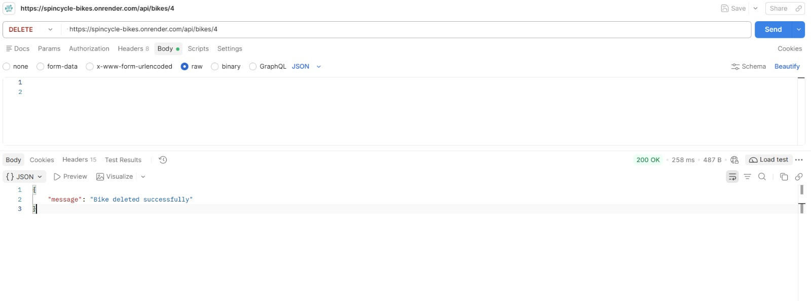

# SpinCycle Bikes – Bike Rental Management System

## 1. Project Overview

**SpinCycle Bikes** is a Bike Rental Management System developed using Node.js, Express.js, and SQLite. It provides REST APIs to manage bike records, search bikes by type, validate user inputs, handle pagination, and retrieve rental details.

This project demonstrates backend development, database integration, REST API creation, middleware implementation, SQL queries, and API testing using Postman.

## 2. Features

- View all bikes.
- Retrieve bike details using bike ID.
- Add new bikes.
- Update existing bike details.
- Delete bikes.
- Search bikes by type.
- Pagination for bike listings.
- Input validation using middleware.
- Retrieve rental details using SQL JOIN.
- SQLite database integration.

## 3. Technologies Used

| Technology | Purpose |
|---|---|
| Node.js | JavaScript runtime |
| Express.js | Backend framework |
| SQLite | Database |
| JavaScript | Programming language |
| Postman | API testing |
| Git & GitHub | Version control |
| Render | Deployment |

## 4. Project Structure

```text
SpinCycle-Bikes/
│
├── controllers/
│   ├── bikeController.js
│   └── rentalController.js
│
├── database/
│   ├── dbConnection.js
│   ├── schema.sql
│   └── sampleData.sql
│
├── middleware/
│   ├── validation.js
│   ├── search.js
│   └── pagination.js
│
├── routes/
│   ├── bikeRoutes.js
│   └── rentalRoutes.js
│
├── Screenshots/
│   ├── get all.png
│   ├── get by id.jpeg
│   ├── Add a bike-POST.jpeg
│   ├── Update a bike- PUT.jpeg
│   ├── DELETE.jpeg
│   ├── Search for Mountain bikes.jpeg
│   ├── Search for a type that does not exist.jpeg
│   ├── Missing bike name.jpeg
│   ├── Missing bike type.jpeg
│   ├── Invalid bike status.jpeg
│   ├── rental details-JOIN.jpeg
│   ├── test 1.jpeg
│   ├── test 2.jpeg
│   └── test 3.jpeg
│
├── postman/
│   └── SpinCycle-Collection.json
│
├── server.js
├── package.json
└── README.md
```

## 5. Database Design

The project uses three relational tables.

### Bikes Table

Stores bike information.

| Column | Description |
|---|---|
| bike_id | Primary key |
| bike_name | Name of the bike |
| type | Bike category |
| status | Available, Rented, or Maintenance |

### Riders Table

Stores customer information.

| Column | Description |
|---|---|
| rider_id | Primary key |
| name | Rider name |
| email | Rider email |

### Rentals Table

Stores rental information.

| Column | Description |
|---|---|
| rental_id | Primary key |
| rider_id | Foreign key |
| bike_id | Foreign key |
| rental_date | Rental date |
| return_date | Return date |

**Relationships:**
- One rider can have multiple rental records.
- One bike can have multiple rental records over time.
- Rentals connects Riders and Bikes using foreign keys.

## 6. Installation and Setup

### Prerequisites

- Node.js
- Visual Studio Code
- Postman

### Step 1: Clone the Repository

```bash
git clone https://github.com/gopularamarchitha-ui/SpinCycle-Bikes.git
```

### Step 2: Navigate to the Project Folder

```bash
cd SpinCycle-Bikes
```

### Step 3: Install Dependencies

```bash
npm install
```

### Step 4: Start the Server

```bash
npm start
```

The server runs at:

```text
http://localhost:3000
```

## 7. API Documentation

All API endpoints use the `/api` prefix.

### Bike Management APIs

| Method | Endpoint | Description |
|---|---|---|
| GET | `/api/bikes` | Get all bikes |
| GET | `/api/bikes/:id` | Get bike by ID |
| POST | `/api/bikes` | Add a bike |
| PUT | `/api/bikes/:id` | Update a bike |
| DELETE | `/api/bikes/:id` | Delete a bike |

### Rental API

| Method | Endpoint | Description |
|---|---|---|
| GET | `/api/rentals/details` | Retrieve rental details using JOIN |

## 8. API Request Examples

### Get All Bikes

```http
GET /api/bikes
```

### Get Bike by ID

```http
GET /api/bikes/1
```

### Add a Bike

```http
POST /api/bikes
```

Request Body:

```json
{
  "bike_name": "Electric Bike",
  "type": "Electric",
  "status": "Available"
}
```

### Update Bike

```http
PUT /api/bikes/1
```

Request Body:

```json
{
  "bike_name": "Premium Mountain Bike",
  "type": "Mountain",
  "status": "Available"
}
```

### Delete Bike

```http
DELETE /api/bikes/4
```

### Get Rental Details

```http
GET /api/rentals/details
```

## 9. Search and Pagination

### Search Bikes by Type

```http
GET /api/bikes?type=Mountain
```

### Pagination

```http
GET /api/bikes?page=1&limit=2
```

```http
GET /api/bikes?page=2&limit=2
```

### Combined Search and Pagination

```http
GET /api/bikes?type=Mountain&page=1&limit=2
```

## 10. Middleware and Validation

### Validation Middleware

- Bike name must not be empty.
- Bike type must not be empty.
- Bike status must be Available, Rented, or Maintenance.
- Bike ID must be a positive integer.

### Search Middleware

- Searches bikes based on bike type.
- Uses SQL LIKE conditions.

### Pagination Middleware

- Accepts page and limit parameters.
- Validates positive integer values.
- Calculates the database offset.

## 11. Postman API Testing and Screenshots

The following screenshots demonstrate the actual API requests and responses tested using Postman.

### A. Bike CRUD Operations

**1. Get All Bikes**


**2. Get Bike by ID**


**3. Add a Bike (POST)**


**4. Update a Bike (PUT)**


**5. Delete a Bike**



### B. Search and Validation

**6. Search for Mountain Bikes**


**7. Search for a Non-Existing Bike Type**


**8. Missing Bike Name Validation**


**9. Missing Bike Type Validation**


**10. Invalid Bike Status Validation**


### C. Rental JOIN and Additional Tests

**11. Rental Details Using SQL JOIN**


**12. Additional Test 1**


**13. Additional Test 2**


**14. Additional Test 3**


## 12. HTTP Status Codes

| Status Code | Description |
|---|---|
| 200 | Request successful |
| 201 | Resource created successfully |
| 400 | Invalid request |
| 404 | Resource not found |
| 500 | Internal server error |

## 13. Deployment

**GitHub Repository:**

https://github.com/gopularamarchitha-ui/SpinCycle-Bikes

**Live Deployment:**

https://spincycle-bikes.onrender.com

## 14. Team Contributions

| Work Area | Responsibilities |
|---|---|
| Member 1 | Server setup and API integration |
| Member 2 | Database design and sample data |
| Member 3 | Bike CRUD operations and Rental JOIN |
| Member 4 | Search and validation middleware |
| Member 5 | Pagination, testing, and documentation |

## 15. Learning Outcomes

Through this project, we gained practical experience in:

- REST API development using Node.js and Express.js.
- SQLite database connectivity.
- CRUD operations.
- SQL JOIN queries.
- Middleware implementation.
- Search and pagination.
- API testing using Postman.
- Git and GitHub collaboration.
- Backend application deployment.

## 16. Conclusion

SpinCycle Bikes is a Bike Rental Management System developed using Node.js, Express.js, and SQLite. The project demonstrates how database management, REST APIs, CRUD operations, SQL JOIN queries, middleware, and API testing work together in a practical backend application.
